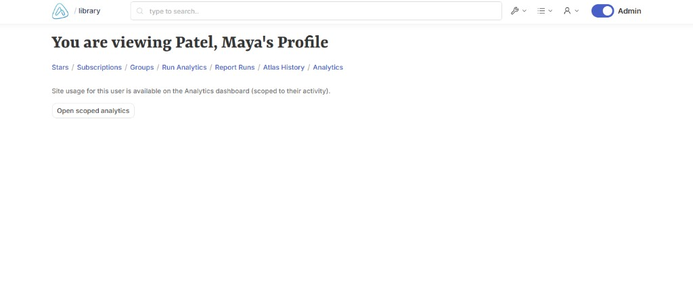
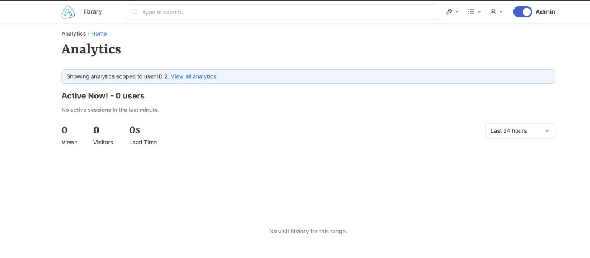
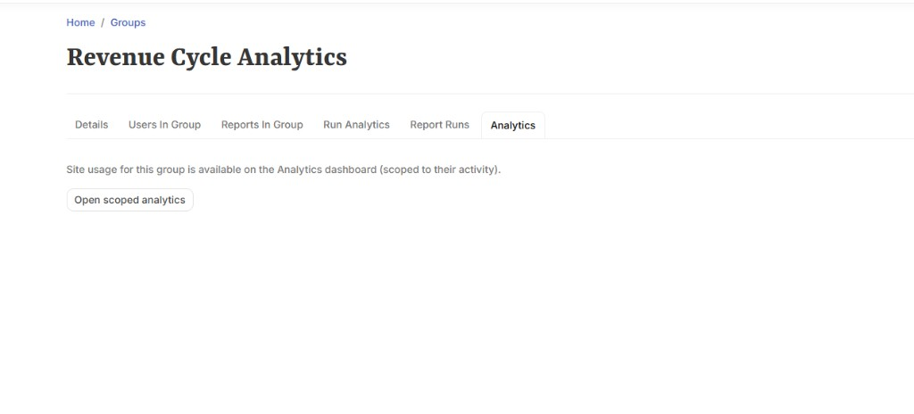
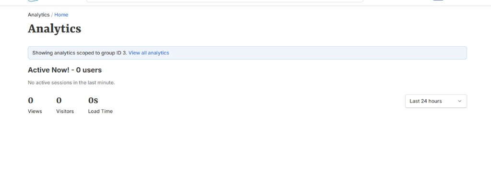
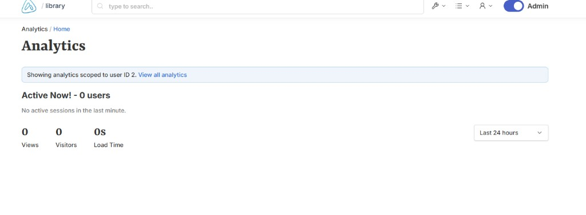

## Screenshots

### Screenshot 1 — User profile Analytics tab → scoped dashboard

`/users?id=2#analytics` → **Open scoped analytics** → `/analytics?userId=2`

### Screenshot 2 — Group Analytics tab → scoped dashboard

`/groups?id=3` (Revenue Cycle Analytics) → **Analytics** tab → **Open scoped analytics** → `/analytics?groupId=3`

### Screenshot 3 — Scoped banner on analytics (user)

Confirms the dashboard reads the `userId` query and shows the scoped notice (not site-wide analytics).

